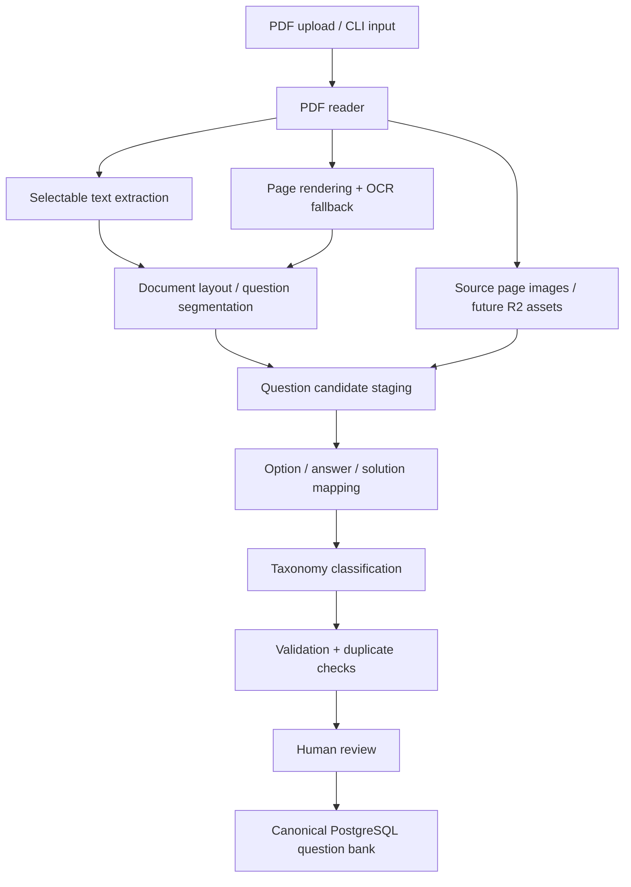

# PrepFreeX Ingestion Engine — Architecture

## Purpose

A local-first PDF-to-question-bank ingestion pipeline. It extracts question candidates, retains source-page evidence, classifies candidates against an existing JEE Main taxonomy, validates structured records, and stages all candidates for review before canonical publication.

## Pipeline

## Important separation

- `ingestion_question_candidates` holds extracted but unapproved records.
- `questions` holds canonical records after validation/import.
- A question in the staging table is not automatically eligible for an assessment.
- `v_test_eligible_questions` is the server-side publication gate.

## Modules

- `pdf_reader.py`: PyMuPDF text extraction, SHA-256, raster rendering, optional Tesseract OCR.
- `segmenter.py`: known MathonGo question-bank layout and generic line/state-machine segmentation.
- `profiles.py`: high-precision, visually assisted profile for the supplied five-question MathonGo PDF.
- `taxonomy.py`: parses subject/unit structure from the supplied syllabus and creates unreviewed candidate topics; includes the curated Physics Unit 14 working taxonomy.
- `classifier.py`: conservative local rules fallback plus optional OpenAI-compatible classification endpoint.
- `pipeline.py`: orchestrates extraction, classification, artifact generation and report creation.
- `database.py`: PostgreSQL migrations, taxonomy seeding, candidate staging and canonical import.
- `api.py`: basic FastAPI PDF upload endpoint for local development.

## Data stores

PostgreSQL stores source metadata, page extraction text, ingestion jobs, candidate questions, taxonomy, canonical questions, tags, options, revisions, classification runs and review records.

The current version stores rendered page images in the local `artifacts/` directory. Cloudflare R2 is the planned object store; an R2 adapter and signed upload/download flow are intentionally not implemented yet.

## Classification behaviour

The rules classifier is a low-cost fallback and is deliberately conservative. The optional LLM adapter accepts an OpenAI-compatible chat-completions endpoint configured through environment variables. The model is restricted to supplied taxonomy codes. Low-confidence or incomplete results remain `needs_review`.

The generated topic/subtopic nodes from the syllabus are candidate taxonomy nodes, not official NTA topic labels. The current seed contains 193 candidate topics and 333 candidate subtopics. They have `is_reviewed=false` and require taxonomy-owner/subject-matter review before production classification.

## Known MVP limitations

1. Generic segmentation is layout-sensitive and is not guaranteed to recover all question boundaries from arbitrary PDFs.
2. OCR output for mathematics, chemical notation and diagrams requires visual review. Scanned PDFs are OCR-rendered at a lower working DPI; source-page images are retained for review.
3. Generic answer-key and solution matching is not yet automated across arbitrary paper layouts.
4. Automatic figure-region cropping is not implemented; source-page snapshots are retained.
5. The initial MathonGo pilot profile provides a known five-question test fixture. A broader set of layout profiles is needed for coaching-institute variation.
6. The optional LLM adapter expects an OpenAI-compatible endpoint; provider-specific authentication and response-format differences may need an adapter.

## Safety

All source documents default to `license_status=unverified`. All extracted candidates default to review. Questions with pending figures, unverified answers, unverified explanations (when present), or uncleared sources cannot pass the eligibility view.
