# PrepFreeX — Target Entity-Relationship (ER) Model

This document outlines the complete relational schema spanning the Canonical Question Bank, Ingestion & Audit Staging, and the Assessment Engine.

---

## 1. Complete ER Diagram

```mermaid
erDiagram
    %% INGESTION & STAGING TIER
    SOURCE_DOCUMENTS ||--o{ INGESTION_JOBS : "triggers"
    SOURCE_DOCUMENTS ||--o{ QUESTION_SOURCES : "referenced_in"
    INGESTION_JOBS ||--o{ DOCUMENT_PAGES : "renders"
    INGESTION_JOBS ||--o{ INGESTION_QUESTION_CANDIDATES : "extracts"
    INGESTION_JOBS ||--o{ CLASSIFICATION_RUNS : "logs"
    INGESTION_JOBS ||--o{ INGESTION_ERRORS : "records"

    %% TAXONOMY TIER
    TAXONOMY ||--o{ TAXONOMY : "parent_of"
    TAXONOMY ||--o{ QUESTION_TAGS : "categorizes"
    TAXONOMY ||--o{ TAXONOMY_PROPOSALS : "proposed_under"

    %% CANONICAL QUESTION BANK TIER
    QUESTIONS ||--o{ QUESTION_OPTIONS : "has_choices"
    QUESTIONS ||--o{ QUESTION_MATCH_ITEMS : "has_pairs"
    QUESTIONS ||--o{ QUESTION_TAGS : "tagged_with"
    QUESTIONS ||--o{ QUESTION_ASSETS : "displays_diagrams"
    QUESTIONS ||--o{ QUESTION_SOURCES : "derived_from"
    QUESTIONS ||--o{ QUESTION_REVISIONS : "version_history"
    QUESTIONS ||--o{ REVIEW_RECORDS : "human_audit"
    QUESTIONS ||--o{ QUESTION_RELATIONS : "related_to"

    %% ASSESSMENT ENGINE TIER
    ASSESSMENT_DEFINITIONS ||--o{ ASSESSMENT_VERSIONS : "versioned_as"
    ASSESSMENT_VERSIONS ||--o{ ASSESSMENT_SECTIONS : "partitioned_into"
    ASSESSMENT_VERSIONS ||--o{ ASSESSMENT_ATTEMPTS : "instantiated_as"
    ASSESSMENT_SECTIONS ||--o{ ASSESSMENT_SELECTION_RULES : "configured_by"
    ASSESSMENT_ATTEMPTS ||--o{ ASSESSMENT_ATTEMPT_QUESTIONS : "presents"
    ASSESSMENT_ATTEMPT_QUESTIONS ||--o{ ATTEMPT_RESPONSES : "records_input"
    ASSESSMENT_ATTEMPTS ||--|| ASSESSMENT_RESULTS : "computes"
    ASSESSMENT_ATTEMPTS ||--o{ QUESTION_EXPOSURES : "logs_history"
    ASSESSMENT_ATTEMPTS ||--o{ ADAPTIVE_DECISIONS : "guides"

    %% ENTITY DEFINITIONS & FIELDS
    SOURCE_DOCUMENTS {
        uuid id PK
        text sha256 UK
        text title
        text publisher
        text exam
        int exam_year
        text file_path
        text license_status
        timestamptz created_at
    }

    INGESTION_JOBS {
        uuid id PK
        uuid source_doc_id FK
        text original_filename
        text sha256
        text status
        text document_type
        int page_count
        int extracted_question_count
        timestamptz created_at
    }

    TAXONOMY {
        bigserial id PK
        text taxonomy_version
        text code UK
        bigint parent_id FK
        text level
        text name
        text syllabus_text
        boolean is_active
    }

    QUESTIONS {
        uuid id PK
        text public_id UK
        int version
        uuid source_doc_id FK
        text subject
        text question_type
        text stem_md
        jsonb answer
        text explanation_md
        smallint difficulty
        text cognitive_level
        text[] formulas_used
        text[] keywords
        text[] concept_tags
        text[] skill_tags
        boolean has_figure
        text figure_status
        text status
        text content_hash
        timestamptz created_at
    }

    QUESTION_OPTIONS {
        uuid question_id PK, FK
        smallint position PK
        text label_printed
        text text_md
    }

    QUESTION_TAGS {
        uuid question_id PK, FK
        bigint taxonomy_id PK, FK
        boolean is_primary
        real confidence
        text source
        text tagger_version
    }

    QUESTION_SOURCES {
        uuid question_id PK, FK
        uuid source_doc_id PK, FK
        text relationship PK
        text source_q_label
        int source_page_start
        int source_page_end
        text source_notes
    }

    QUESTION_RELATIONS {
        bigserial id PK
        uuid question_id_a FK
        uuid question_id_b FK
        text relationship_type
        real similarity_score
        text rationale
    }

    QUESTION_ASSETS {
        uuid id PK
        uuid question_id FK
        text role
        text storage_backend
        text storage_bucket
        text storage_key
        text mime
        int width
        int height
        text sha256
    }

    ASSESSMENT_DEFINITIONS {
        uuid id PK
        text slug UK
        text title
        text assessment_type
        text subject
        boolean is_active
    }

    ASSESSMENT_VERSIONS {
        uuid id PK
        uuid assessment_def_id FK
        int version_number
        int duration_minutes
        int total_marks
        jsonb scoring_rules
        boolean is_published
    }

    ASSESSMENT_SECTIONS {
        uuid id PK
        uuid assessment_version_id FK
        int section_order
        text name
        text subject
        text section_type
        int questions_to_attempt
        int total_questions
    }

    ASSESSMENT_ATTEMPTS {
        uuid id PK
        uuid learner_id
        uuid assessment_version_id FK
        text status
        timestamptz started_at
        timestamptz expires_at
        timestamptz submitted_at
        text submission_idempotency_key UK
        real score_obtained
    }

    ASSESSMENT_ATTEMPT_QUESTIONS {
        bigserial id PK
        uuid attempt_id FK
        uuid question_id FK
        uuid section_id FK
        int display_order
        jsonb question_snapshot
        jsonb correct_answer_snapshot
        real marks_correct
        real marks_incorrect
    }

    ATTEMPT_RESPONSES {
        bigserial id PK
        bigint attempt_question_id UK, FK
        uuid attempt_id FK
        jsonb response_data
        boolean is_answered
        boolean is_marked_for_review
        boolean is_correct
        real score_awarded
    }

    ASSESSMENT_RESULTS {
        uuid id PK
        uuid attempt_id UK, FK
        uuid learner_id
        int total_questions
        int correct_count
        int incorrect_count
        real score
        real max_score
        real accuracy_percentage
        jsonb subject_breakdown
    }

    LEARNER_TOPIC_MASTERY {
        bigserial id PK
        uuid learner_id
        text taxonomy_code
        text taxonomy_level
        real mastery_score
        int attempts_count
        int correct_count
        timestamptz updated_at
    }
```

---

## 2. Foreign Key & Constraint Matrix

| Source Table | Source Column | Target Table | Target Column | On Delete Action | Integrity Purpose |
| :--- | :--- | :--- | :--- | :--- | :--- |
| `ingestion_jobs` | `source_doc_id` | `source_documents` | `id` | `SET NULL` | Preserves job run history even if source doc record is purged. |
| `document_pages` | `ingestion_job_id` | `ingestion_jobs` | `id` | `CASCADE` | Deletes page metadata if job is dropped. |
| `questions` | `source_doc_id` | `source_documents` | `id` | `RESTRICT` | Cannot delete a source PDF if questions reference it as their origin. |
| `question_options` | `question_id` | `questions` | `id` | `CASCADE` | Question options belong exclusively to their parent question. |
| `question_tags` | `question_id` | `questions` | `id` | `CASCADE` | Tags are removed when question is deleted. |
| `question_tags` | `taxonomy_id` | `taxonomy` | `id` | `RESTRICT` | Cannot delete an active taxonomy node that categorizes live questions. |
| `question_sources` | `question_id` | `questions` | `id` | `RESTRICT` | Preserves provenance links. |
| `question_sources` | `source_doc_id` | `source_documents` | `id` | `RESTRICT` | Preserves multi-paper references. |
| `assessment_versions` | `assessment_def_id` | `assessment_definitions` | `id` | `RESTRICT` | Cannot delete an assessment definition that has published versions. |
| `assessment_sections` | `assessment_version_id` | `assessment_versions` | `id` | `CASCADE` | Sections cascade with version deletion. |
| `assessment_attempts` | `assessment_version_id` | `assessment_versions` | `id` | `RESTRICT` | Cannot delete an assessment version that learners have attempted. |
| `assessment_attempt_questions` | `attempt_id` | `assessment_attempts` | `id` | `CASCADE` | Attempt questions cascade with attempt. |
| `assessment_attempt_questions` | `question_id` | `questions` | `id` | `RESTRICT` | Questions in learner test history are strictly preserved. |
| `attempt_responses` | `attempt_question_id` | `assessment_attempt_questions` | `id` | `CASCADE` | Responses cascade with attempt question. |
| `assessment_results` | `attempt_id` | `assessment_attempts` | `id` | `CASCADE` | Computed report belongs 1:1 with attempt. |

